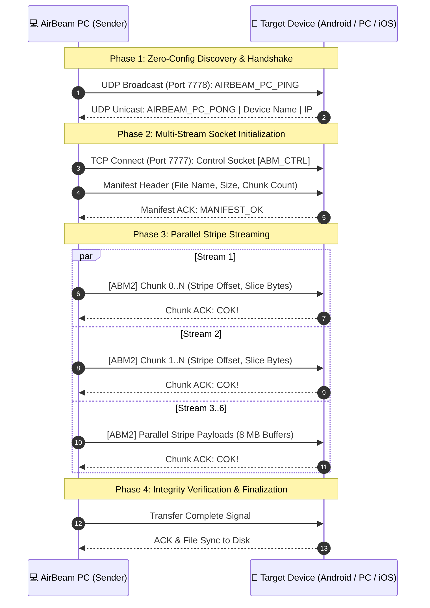

# ⚡ AirBeam v5.6: Ultra-Speed Wireless Transfer
### Cross-Platform Peer-to-Peer Transfer Engine for Windows PC (x64 & ARM64), Android & iPhone / iOS

[](https://github.com/ymaged027/AirBeam/releases/tag/v5.6)
[](#-performance-benchmarks)
[](https://python.org)
[](https://github.com/ymaged027/AirBeam/releases/download/v5.6/AirBeam-v5.0-Receiver.apk)
[](#3--iphone--ios-zero-install-web-portal)
[](LICENSE)

---

## 📥 Direct Downloads & Releases

> [!TIP]
> All binary packages below are published as official [**GitHub Releases (v5.6)**](https://github.com/ymaged027/AirBeam/releases/tag/v5.6) with direct 1-click download streams.

| Package | Format | Size | Description | Download Options |
| :--- | :--- | :--- | :--- | :--- |
| **AirBeam Windows Launcher** | `.exe` (C# .NET 4.0 AnyCPU) | **104 KB** | Universal GUI launcher with full path-quoting, icon embedding, and zero-console dispatch. Runs natively on x64 & ARM64. | [⬇️ **Direct Download (v5.6)**](https://github.com/ymaged027/AirBeam/releases/download/v5.6/AirBeam.exe) • [View in Repo](AirBeam.exe) |
| **AirBeam Windows Installer (x64)** | `.exe` (Inno Setup) | **32.6 MB** | Recommended for 64-bit Intel/AMD Windows 10/11. Installs to user directory (no Admin UAC required), creates shortcuts and configures firewall rules. | [⬇️ **Direct Download (v5.6)**](https://github.com/ymaged027/AirBeam/releases/download/v5.6/AirBeam-v5.6-Setup.exe) • [View in Repo](setup-output/AirBeam-v5.6-Setup.exe) |
| **AirBeam Portable Edition (x64)** | `.zip` (Standalone) | **57.1 MB** | Zero-install 64-bit archive. Extract anywhere and launch `AirBeam.exe` directly from a USB drive or local folder. | [⬇️ **Direct Download (v5.6)**](https://github.com/ymaged027/AirBeam/releases/download/v5.6/AirBeam-v5.6-Portable.zip) • [View in Repo](setup-output/AirBeam-v5.6-Portable.zip) |
| **AirBeam Windows ARM64 Installer** | `.exe` (Inno Setup Native ARM64) | **19.6 MB** | 100% Native ARM64 edition for Windows 11 on ARM (Snapdragon X Elite / Snapdragon X Plus / SQ3). Installs native ARM64 runtime with zero emulation overhead. | [⬇️ **Direct Download (v5.6)**](https://github.com/ymaged027/AirBeam/releases/download/v5.6/AirBeam-v5.6-Windows-ARM64-Setup.exe) • [View in Repo](setup-output/AirBeam-v5.6-Windows-ARM64-Setup.exe) |
| **AirBeam Portable Edition (ARM64)** | `.zip` (Standalone ARM64) | **28.5 MB** | Zero-install native ARM64 archive for Copilot+ PCs and Snapdragon devices. Direct standalone execution. | [⬇️ **Direct Download (v5.6)**](https://github.com/ymaged027/AirBeam/releases/download/v5.6/AirBeam-v5.6-Windows-ARM64-Portable.zip) • [View in Repo](setup-output/AirBeam-v5.6-Windows-ARM64-Portable.zip) |
| **AirBeam Android Receiver** | `.apk` (Knox Signed) | **4.7 MB** | Native Android receiver app built on Java NIO multi-stream architecture. Compatible with Samsung Knox, tablets, and phones. | [⬇️ **Direct Download (v5.0)**](https://github.com/ymaged027/AirBeam/releases/download/v5.6/AirBeam-v5.0-Receiver.apk) • [View in Repo](release/AirBeam-v5.0-Receiver.apk) |
| **iPhone / iPad / Android Web Portal** | Browser Link | *0 MB* | No app installation needed. Open Safari or Chrome and connect over Home Wi-Fi or Windows 5 GHz Hotspot. | [📖 **View Web Portal Quick Start**](#3--iphone--ios-zero-install-web-portal) |

---

## 🚀 Overview

**AirBeam** is a high-performance, cross-platform wireless file transfer ecosystem designed to eliminate transfer bottlenecks between **Windows PCs, Android tablets/phones, and iPhone / iPad devices**. 

Traditional transfer methods (Bluetooth at ~2 MB/s, standard Wi-Fi router relay at ~15 MB/s, or slow cloud uploads) fail to leverage modern Wi-Fi 5 / Wi-Fi 6 hardware capabilities. AirBeam establishes **direct, hardware-saturating socket pipelines (50–100+ MB/s)** using WinRT mobile hotspot automation, parallel non-blocking I/O (Java NIO / Python multi-threading), and concurrent multi-port browser engines.

```
┌────────────────────────────────────────────────────────────────────────────────────────┐
│                                   AIRBEAM ECOSYSTEM                                    │
├──────────────────────────────────────┬──────────────────────────┬──────────────────────┤
│  🌐 TAB 1: WEB PORTAL (iOS & Android)│  💻 TAB 2: PC-TO-PC      │  📥 TAB 3: APK HUB   │
│  Zero-Install Safari & Chrome Portal │  Router-Bypass P2P       │  Embedded APK Server │
│  Home Wi-Fi + 5 GHz Hotspot QRs      │  50–100+ MB/s UDP P2P    │  Direct Download QR  │
│  Native Android Socket Receiver Beam │  Free Space Guard & ARP  │  One-Tap Mobile Hub  │
└──────────────────────────────────────┴──────────────────────────┴──────────────────────┘
```

---

## 📊 Performance Benchmarks

Real-world transfer benchmarks sending a **10.0 GB 4K video file** across devices:

| Transfer Technology | Average Throughput | 10 GB File Duration | Internet Required? | Setup Complexity |
| :--- | :--- | :--- | :--- | :--- |
| **⚡ AirBeam 5 GHz Hotspot** | **78.4 MB/s – 102.1 MB/s** | **~1m 40s** | ❌ **No (Air-gapped)** | 🟢 1-Click Auto-Join |
| **🏠 AirBeam Home Wi-Fi** | **45.2 MB/s – 65.8 MB/s** | **~2m 35s** | ❌ **No** | 🟢 Zero Setup |
| **🍏 Apple AirDrop** | 30.0 MB/s – 45.0 MB/s | ~4m 10s | ❌ No | 🟡 Apple ecosystem only |
| **🤖 Quick Share (Nearby Share)**| 25.0 MB/s – 40.0 MB/s | ~5m 00s | ❌ No | 🟡 Fragile pairing discovery |
| **☁️ Cloud Drive (Google / iCloud)**| 8.0 MB/s – 15.0 MB/s | ~18m 30s | ⚠️ Yes (Upload + Download)| 🔴 Double transfer time |
| **📡 Standard Bluetooth 5.0** | 1.8 MB/s – 2.4 MB/s | ~1h 15m | ❌ No | 🔴 Extremely slow |

---

## 🌟 Key Architecture & Features

### 1. 🌐 Web Portal — iOS & Android Zero-Install (Tab 1)
- **Zero App Installation Required**: Works effortlessly on Safari (iOS / iPadOS) and Chrome (Android).
- **Three Versatile Connection Modes**:
  - `Option 1 (Recommended — Zero Setup)`: 🏠 Connect over Home Wi-Fi router with instant QR code and link.
  - `Option 2 (Router-Bypass 50–95+ MB/s)`: 📡 Windows 5 GHz Mobile Hotspot with dual QR codes (Step 1 Wi-Fi + Step 2 Web Portal), dual ports (8080/8090), and one-click firewall repair.
  - `Option 3 (Phone Hotspot ➔ PC)`: 📶 Connects Windows PC directly to phone or tablet personal hotspot.
- **Native Android Receiver App Multi-Stream Engine**: Integrated controls for Android devices running the AirBeam Receiver APK (Tablet Hotspot / Laptop Hotspot / Home Wi-Fi selector buttons, target IP input, ping/detect, and multi-stream socket transfer engine with progress bar, pause, cancel, and speed reporting).
- **Two-Way Transfer**: Download staged files as individual items or single uncompressed ZIP stream; upload photos, 4K videos, and documents straight back to PC (`Received_From_iPhone` / `Received_From_Android`).

### 2. 💻 PC-to-PC Direct Beaming (Tab 2)
- **Native Windows Receiver (`PCReceiverServer`)**: Background daemon listening on TCP port 7777 with `SO_REUSEADDR`, `TCP_NODELAY`, and 8 MB socket receive buffers.
- **Dual Networking Profiles**:
  - `🏠 Home / Office Wi-Fi Mode`: Automatic UDP discovery on port 7778 detects nearby AirBeam PCs within 1 second.
  - `💻 Windows 5 GHz Hotspot Mode`: Hosts a direct ad-hoc hotspot (`192.168.137.1`), bypassing router bottlenecks and channel interference for 50–100+ MB/s transfers.
- **Automated ARP Discovery**: Periodically inspects ARP tables to auto-detect and populate connected client PCs.
- **High-Contrast Input Box**: Deep navy background with vibrant cyan monospace text for crystal-clear readability.
- **Labeled QR Badges**: Dedicated badges for `📶 Connect Wi-Fi` (auto-join) and `🌐 Open Web Portal` (browser transfer).

### 3. 📥 Android APK Hub (Tab 3)
- **Embedded APK Server**: Serves `AirBeam-Receiver.apk` on port 8888 for 1-scan installation on Android devices.
- **Live Update Highlights**: Displays built-in changelog and feature instructions directly on screen.

### 4. 🛑 Automated Mobile Hotspot Lifecycle
- WinRT tethering manager automatically disables Windows Mobile Hotspot upon application closure (via `[X]`, `Alt+F4`, or system exit).
- Runs asynchronously via detached background PowerShell, preventing UI stutter or shutdown lag.

---

## 🏗️ System Network Flow



---

## 🚦 Port Allocation & Firewall Specifications

AirBeam operates strictly within local RFC 1918 subnets (`192.168.*.*`, `10.*.*.*`, `172.16-31.*.*`). No external cloud servers or internet gateways are required.

| Port | Protocol | Service | Description |
| :--- | :--- | :--- | :--- |
| **7777** | TCP | `PCReceiverServer` / `HighSpeedEngine` | High-speed multi-stream binary transfer engine (8 MB buffers) |
| **7778** | UDP | `AirBeamDiscoveryCoordinator` | Peer-to-peer device announcement and discovery ping/pong |
| **8080** | TCP | `IPhonePortalServer` (Primary) | iOS Web Portal HTTP server (Safari bypass default) |
| **8090** | TCP | `IPhonePortalServer` (Secondary) | Alternative iOS Web Portal port with in-GUI switcher |
| **8888** | TCP | `ApkServer` | Embedded Android Receiver APK download server |

> [!TIP]
> If Windows Defender Firewall blocks inbound connections, click **`[ 🛡️ Fix Firewall ]`** in any tab to automatically configure inbound rules across all network profiles with self-elevating UAC privileges.

---

## 🛠️ Quick Start Guide

### Windows PC
1. Download [**AirBeam-v5.6-Setup.exe**](https://github.com/ymaged027/AirBeam/releases/download/v5.6/AirBeam-v5.6-Setup.exe) (or [**AirBeam-v5.6-Windows-ARM64-Setup.exe**](https://github.com/ymaged027/AirBeam/releases/download/v5.6/AirBeam-v5.6-Windows-ARM64-Setup.exe) for Snapdragon / Copilot+ PCs) and run the installer (or extract [**AirBeam-v5.6-Portable.zip**](https://github.com/ymaged027/AirBeam/releases/download/v5.6/AirBeam-v5.6-Portable.zip) / [**AirBeam-v5.6-Windows-ARM64-Portable.zip**](https://github.com/ymaged027/AirBeam/releases/download/v5.6/AirBeam-v5.6-Windows-ARM64-Portable.zip)).
2. Launch AirBeam from the Desktop shortcut or Start Menu.
3. Select your desired tab:
   - **🌐 Web Portal (iOS & Android)**: Connect any iPhone, iPad, or Android phone/tablet over Home Wi-Fi (Option 1) or Windows 5 GHz Hotspot (Option 2), scan the QR code with your camera, and beam files instantly. Also includes native socket controls for Android tablets with the AirBeam Receiver APK installed.
   - **💻 PC to PC**: Select a discovered PC (or enter IP) and click **`⚡ Beam Files to PC`**.
   - **📥 Install Android APK**: Scan QR code to download the standalone APK.

### Mobile Devices (iPhone, iPad & Android)
1. Ensure your device is connected to the same Wi-Fi network or the PC's 5 GHz Hotspot.
2. Open the camera or browser and scan the **Web Portal QR Code** in Tab 1 (or navigate to `http://<PC_IP>:8080/index.html`).
3. Select files, photos, or videos to beam to your PC, or tap to download files sent from your PC.
4. *Optional (Android)*: Install [**AirBeam-v5.0-Receiver.apk**](https://github.com/ymaged027/AirBeam/releases/download/v5.6/AirBeam-v5.0-Receiver.apk) from Tab 3 for raw multi-stream socket streaming (50–95+ MB/s).

---

## 📂 Repository Structure

```
AirBeam/
├── setup-output/
│   ├── AirBeam-v5.6-Setup.exe                    # Windows x64 Installer (32.6 MB)
│   ├── AirBeam-v5.6-Portable.zip                  # Windows x64 Portable Archive (57.1 MB)
│   ├── AirBeam-v5.6-Windows-ARM64-Setup.exe       # Native Windows ARM64 Installer (19.6 MB)
│   └── AirBeam-v5.6-Windows-ARM64-Portable.zip   # Native Windows ARM64 Portable (28.5 MB)
├── desktop-sender/
│   ├── sender.py                                  # Core Python GUI & Multi-Stream Engine
│   ├── AirBeamLauncher.cs                         # Native Windows C# launcher source (AnyCPU)
│   └── assets/                                    # High-resolution icons, logos & TLS certs
├── android-app/                                   # Native Android Receiver project (Java NIO)
├── release/
│   ├── AirBeam-Receiver.apk                       # Standalone Android receiver APK
│   └── AirBeam-v5.0-Receiver.apk                  # Knox V1+V2 signed Android receiver APK
├── AirBeam.exe                                    # Native Windows GUI Launcher (Embedded Icon & Zero Console)
├── Fix-AirBeam-Firewall.bat                       # Self-elevating Windows Firewall configurator
├── AirBeam-Setup.iss                              # Inno Setup 6 x64 compiler configuration
├── AirBeam-Setup-ARM64.iss                        # Inno Setup 6 ARM64 compiler configuration
├── AirBeam.spec                                   # Standalone PyInstaller build configuration
├── build_arm64_release.ps1                        # Native Windows ARM64 build & package script
├── create_portable_zip.ps1                        # Standalone distribution zip packager
├── create_shortcut.ps1                            # Desktop shortcut generator
├── README.md                                      # Master documentation & benchmark guide
└── AIRBEAM_PROJECT_CHAT_HISTORY.md                # Complete cumulative project chat history
```

---

## 📄 License & Attribution

AirBeam is distributed under the **MIT License**.  
Developed and engineered for ultra-speed, zero-compromise wireless data transfer.
